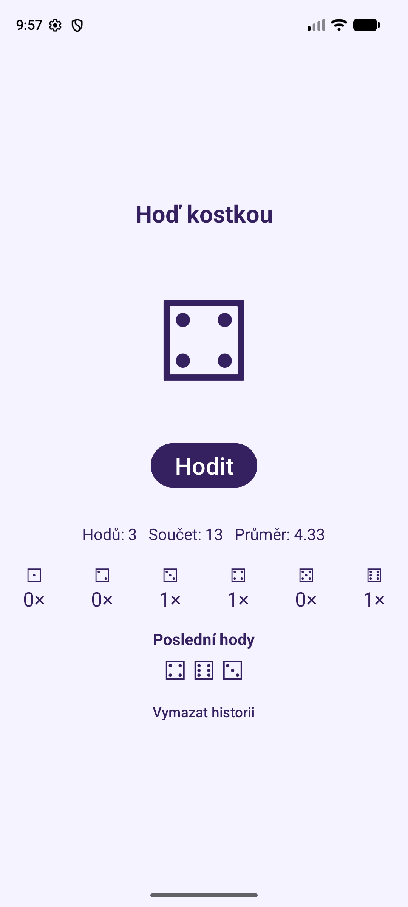
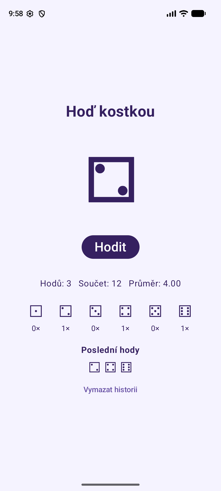

# PMA 2026 – Programování mobilních aplikací

Repozitář k předmětu **Programování mobilních aplikací** (TUL, 2026/2027).

| Složka | Obsah |
|---|---|
| [`MySimpleApp001/`](MySimpleApp001) | **Uhodni číslo** – první aplikace podle [wiki 01 ‐ Příprava prostředí](https://github.com/zizanek/github-tz-pma-2026/wiki/01-%E2%80%90-P%C5%99%C3%ADprava-prost%C5%99ed%C3%AD) (Empty Views Activity, XML + Kotlin) |
| [`MyApp001aDiceThrowXML/`](MyApp001aDiceThrowXML) | **Hoď kostkou** – XML + Kotlin, přístup k prvkům přes `findViewById` ([úkol 003](https://github.com/zizanek/github-tz-pma-2026/issues/3)) |
| [`MyApp001bDiceThrowCOMPOSE/`](MyApp001bDiceThrowCOMPOSE) | **Hoď kostkou** – Jetpack Compose, rozhraní definované v Kotlinu ([úkol 003](https://github.com/zizanek/github-tz-pma-2026/issues/3)) |

---

## Úkol 003 – Hoď kostkou (XML a Jetpack Compose)

Dvě aplikace se stejnou funkcí: po stisku **Hodit** se kostka desetkrát náhodně změní
(prodleva 250 ms) a pak ukáže výsledný hod. Během animace je tlačítko zakázané,
obsah je vystředěný a odsazený od systémových lišt.

| XML + Kotlin | Jetpack Compose |
|:---:|:---:|
|  |  |

### Jak každá varianta aktualizuje zobrazenou kostku

**XML (imperativně)** – vzhled je v `activity_main.xml`, kód si prvek najde
a jeho text **ručně přepíše**:

```kotlin
tvDice = findViewById(R.id.tvDice)
// ...
tvDice.text = diceSymbols[diceValue - 1]   // přepíše text kostky
btnRoll.isEnabled = false                  // ručně vypne tlačítko
```

Každou změnu musí kód do UI promítnout sám – i statistiky se po hodu
aktualizují voláním `updateStatistics()`.

**Compose (deklarativně)** – UI je funkce, která popisuje, jak obrazovka vypadá
pro aktuální **stav**. Kód mění jen stavové proměnné, překreslení zařídí Compose sám:

```kotlin
var diceValue by rememberSaveable { mutableStateOf(1) }
// ...
Text(text = diceSymbols[diceValue - 1])     // kostka je odvozená ze stavu
Button(enabled = !isRolling, ...)           // tlačítko také
// ...
diceValue = (1..6).random()                 // změna stavu → automatické překreslení
```

| | XML + `findViewById` | Jetpack Compose |
|---|---|---|
| Kde je vzhled | `activity_main.xml` | `@Composable` funkce v Kotlinu |
| Změna kostky | `tvDice.text = …` | `diceValue = …` (stav) |
| Zakázání tlačítka | `btnRoll.isEnabled = false` | `enabled = !isRolling` |
| Animace | `lifecycleScope.launch` + `delay` | `rememberCoroutineScope()` + `delay` |
| Odsazení od lišt | `setOnApplyWindowInsetsListener` | `Modifier.safeDrawingPadding()` |
| Stav při otočení telefonu | `onSaveInstanceState` | `rememberSaveable` |

### Vylepšení (návazný úkol)

V obou verzích navíc:

- **statistiky** – počet hodů, součet a průměr všech hodů,
- **četnost** – kolikrát padla která hodnota,
- **historie** – posledních 10 hodů (nejnovější vlevo) a tlačítko *Vymazat historii*,
- **zachování stavu** při otočení telefonu,
- jednotné barvy (`#352060` na `#F5F3FF`), v XML verzi definované v `colors.xml`.
